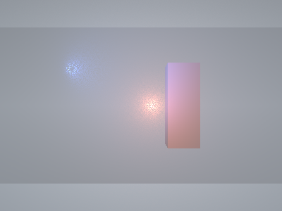
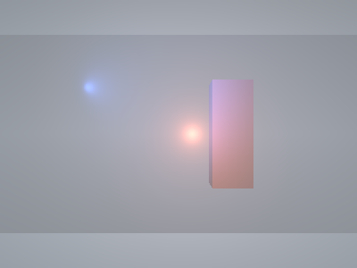
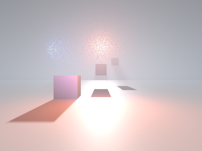
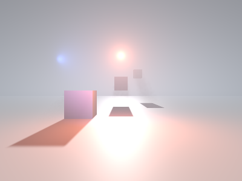

# Fog System & Editor UX Hotfix

Дата: 16 октября 2026. Ветка `scripting`, текущее рабочее дерево. Коммиты и push не выполнялись.

## Editor UX

Предыдущая интеграция Fog добавила отдельный `BeginMenu("Create")` в `DrawMainMenu`, хотя Create уже существовал в `DrawViewport`. Кроме того, Scene содержал старые команды Create Entity/Create Light. Эти три пути объединены: главное меню теперь `File | Edit | View | Scene | Help`, без создания объектов внутри Scene.

`DrawViewportCreateMenu` переиспользует существующие CreatePrimitive/CreateEntity/CreatePlayerStart/CreateLight/CreateFog. Категории: 3D Object (Cube/Sphere/Cylinder/Cone/Plane), Empty Entity, Player/Player Start, Light (Directional/Point/Spot), Environment/Fog. Сохраняются выделение, dirty flag и существующие Undo transactions. В Play меню disabled. Asset Browser Create Asset относится к файлам ассетов и не менялся.

В обычном Viewport используется прежняя кнопка Create. В F11 тот же обработчик отображается поверх изображения слева сверху; размеры изображения, viewport bounds и aspect ratio не уменьшаются. Hover кнопки/открытый popup исключается из viewport picking/capture.

`DrawFogGizmos` рисует облако с полосами тумана на позиции Transform: светлая заливка, тёмная подложка, серый disabled-вариант и жёлтое выделение. Размер учитывает DPI. Иконка клипуется Viewport, поддерживает Ctrl/Shift selection через существующий SelectViewportEntity и работает в F11. В Hierarchy сохранён существующий `[Fog]`. Collider/Rigidbody не добавляются. Transform влияет только на helper, глобальные параметры Fog независимы.

Helper скрыт в Play, Game View и при отключённых editor visuals. Picking уступает активному transform/light/plane gizmo, RMB camera navigation, popup/modal/text input. При отсутствии выделения игнорируется оставшийся от прошлого выделения cached `ImGuizmo::IsOver()`; реальный активный gizmo сохраняет приоритет. После helper-click DrawGizmo пропускается на этот кадр, чтобы вновь выбранный gizmo не начинал drag той же кнопкой.

## Диагностика и rendering

Причина зерна — сочетание редких длинных distance steps с независимым hash на каждом пикселе и резко меняющимся inverse-square Point/Spot вкладом. Соседние лучи случайно попадают в узкий пик около источника или пропускают его. Jitter также возмущал оценку плотности/экстинкции; простое удаление jitter оставляло бы ошибки интегрирования и полосы теней. В старом shader каждый step повторно обходил все lights, вычислял phase/attenuation и directional shadow visibility даже на малозначимых участках.

Изменения сохраняют single-scattering ray integration и существующие FogComponent/Inspector/serialization:

- Transmittance вычисляется по аналитическому HeightIntegral вдоль луча. Для каждого full-resolution пикселя сохраняется собственная глубина, `SceneColor * T + scattering` композится в linear HDR до output/FXAA.
- Ambient, постоянное окружение и directionals без shadow интегрируются аналитически. HG phase математически прежняя, `pow(x, 1.5)` заменён эквивалентным `rsqrt`.
- Primary directional shadow сохраняет stratified 16/32/64 samples Low/Medium/High. Веса сегментов вычисляются через точную разность transmittance; jitter нужен только для visibility. Early-out при T < 1e-4.
- Point/Spot обходятся по одному на луч. Консервативный sphere/ray interval ограничен видимым отрезком: гарантированно не влияющий light пропускается целиком. Нулевые intensity/cone пропускаются, range falloff остаётся прежним.
- Локальный integral использует angular importance quadrature вокруг ближайшей к источнику точки луча. Jacobian учитывает прежний `max(r², nearRadius²)`, не увеличивая near radius и не уменьшая brightness/extinction. Локальный бюджет 8/16/32 хорошо размещённых samples вместо прежних 16/32/64 длинных случайных steps. Независимый CPU oracle сравнивает все три бюджета с 200 000 distance samples для пяти расстояний до луча, включая область near radius; допуск 3,5%.
- Volumetric scattering рассчитывается в ceil(width/2) × ceil(height/2) RGBA32F: RGB — scattering, A — view-depth guide. Полноразмерная 3×3 Gaussian reconstruction фильтрует только scattering. Sky и geometry разделены; depth/slope rejection исключает соседние поверхности, консервативный full-resolution fallback обрабатывает тонкую геометрию без совместимого half-resolution representative. Ветка fallback явно помечена `[branch]`, чтобы дорогой integral не выполнялся спекулятивно для обычных пикселей. SceneColor не размывается.
- Distance/Height shader path не изменён. Temporal history/froxel grid не добавлялись.

DX12 использует прежний 4-descriptor block: t0 SceneColor, t1 depth, t2 shadow, t4 scattering; t3 lights остаётся root SRV. Добавлены две PSO и half-resolution target на существующие frame-slot/pass resources. Barriers переключают volume RTV→SRV перед composite, viewport/scissor восстанавливаются на полный размер, depth возвращается в DEPTH_WRITE. Resize использует прежний retirement mechanism. Fog timestamp охватывает оба draw, а не только half-resolution integration.

## Измерения до/после

GPU: NVIDIA GeForce RTX 4060 Laptop GPU, Release, DX12 debug layer. Источник before — исходные Dx12Fog.cpp/fog.hlsl из HEAD `a8d4c12a4f71f8e3230f617a456e7ba0c681e3c7`. Отдельный диагностический reference executable собран с текущим header/Engine и старым Fog module/shader, чтобы сравнивать одинаковый benchmark без ABI mismatch и отката рабочего дерева. Reference не включён в production CMake/CTest; временные материалы находятся в ignored `out/`.

Общий сценарий в `FogPostHotfixRegression --bench <label>`: одинаковые камера `(0,2,-6)`, объекты, settings, lights и quality. `scene`: пол, три Cube, Directional с shadows, Point и Spot. `near`: стена и foreground Cube, камера рядом с яркими Point/Spot, shadows выключены. Extinction 0,04, height falloff 0,12, base height 2, max distance 70, anisotropy 0,3; AA/environment off. На каждом executable: 100 initial frames, затем 120 warm-up frames и среднее 60 frames на каждый вариант. Before/after запускались последовательно без параллельных нагрузочных тестов.

GPU clocks не зафиксированы; ОС, Present и частоты laptop GPU/CPU дают разброс. Fog CPU — recording/submission на CPU; Frame GPU — существующий profiler, Frame wall — wall time Run(1), включая весь application/present, не чистая CPU-стоимость Fog. Малые изменения этих величин не следует трактовать как универсальный выигрыш FPS.

| Scene | Resolution | Quality | Fog GPU before → after, ms | Change | Fog CPU before → after, ms | Frame GPU before → after, ms | Frame wall before → after, ms |
|---|---|---|---:|---:|---:|---:|---:|
| scene | 400×300 | Low | 0.152 → 0.106 | -30.4% | 0.0136 → 0.0129 | 0.301 → 0.305 | 4.522 → 3.555 |
| scene | 400×300 | Medium | 0.284 → 0.169 | -40.6% | 0.0133 → 0.0125 | 0.621 → 0.359 | 4.058 → 3.345 |
| scene | 400×300 | High | 0.478 → 0.274 | -42.7% | 0.0114 → 0.0167 | 0.779 → 0.550 | 4.349 → 4.251 |
| scene | 1280×720 | Low | 0.890 → 0.521 | -41.4% | 0.0184 → 0.0130 | 1.209 → 0.883 | 5.299 → 3.620 |
| scene | 1280×720 | Medium | 1.451 → 0.622 | -57.1% | 0.0121 → 0.0150 | 1.890 → 1.084 | 5.714 → 4.552 |
| scene | 1280×720 | High | 2.991 → 0.948 | -68.3% | 0.0171 → 0.0177 | 3.500 → 1.249 | 9.180 → 5.691 |
| near | 400×300 | Low | 0.157 → 0.064 | -59.1% | 0.0116 → 0.0254 | 0.287 → 0.238 | 4.057 → 7.201 |
| near | 400×300 | Medium | 0.270 → 0.071 | -73.7% | 0.0163 → 0.0222 | 0.465 → 0.211 | 6.362 → 7.727 |
| near | 400×300 | High | 0.494 → 0.138 | -72.2% | 0.0187 → 0.0168 | 0.828 → 0.306 | 7.093 → 4.797 |
| near | 1280×720 | Low | 0.930 → 0.350 | -62.3% | 0.0206 → 0.0197 | 1.248 → 0.684 | 7.690 → 4.660 |
| near | 1280×720 | Medium | 1.426 → 0.485 | -66.0% | 0.0226 → 0.0159 | 1.673 → 0.795 | 8.755 → 4.274 |
| near | 1280×720 | High | 2.439 → 0.556 | -77.2% | 0.0219 → 0.0160 | 2.923 → 0.834 | 10.443 → 4.187 |

Полные значения: [before CSV](FOG_POST_HOTFIX_PERFORMANCE_BEFORE.csv), [after CSV](FOG_POST_HOTFIX_PERFORMANCE_AFTER.csv). Quality 0/1/2 = Low/Medium/High, steps = directional shadow budget. Полный frame wall **увеличился** у near 400×300 Low/Medium, а Fog CPU иногда вырос из-за второго pass; Fog GPU снизился во всех 12 вариантах. Замер не обещает такой же результат на сцене больницы или другом GPU.

### Разложение стоимости (Medium, scene 1280×720)

| Вариант | Before Fog GPU, ms | After Fog GPU, ms |
|---|---:|---:|
| Все lights + shadow | 1.45135 | 0.62244 |
| Point/Spot выключены | 0.72202 | 0.30343 |
| Только directional shadows выключены | 1.21324 | 0.39980 |
| Constant environment, scene lighting выключен | 0.20932 | 0.11291 |

До исправления включение локальных lights добавляло около 0,729 ms (50% all), directional shadows — около 0,238 ms (16% all). После — около 0,319 и 0,223 ms соответственно. Это ablation estimates, а не независимые hardware counters: compiler branches, частоты и нагрузка не позволяют складывать эти доли как точное разложение. Shadow sampling остаётся существенным расходом после ускорения локального света.

Дополнительная память за cached half-resolution RGBA32F targets (оба frame slots): около 1 MiB при 400×300 и 7,5 MiB при 1280×720. Счётчик Fog resources вырос с 4 195 328 до 5 243 904 bytes и с 31 458 304 до 39 322 624 bytes соответственно. Это осознанный обмен памяти на качество/скорость; существующие полноразмерные HDR targets сохранены.

## Кадры и качество

PNG до/после находятся в [diagnostics/fog-post](diagnostics/fog-post). Сохранены оба сценария Low/Medium/High 400×300 и Medium 1280×720; `.f32` linear HDR и исходные PPM доступны в ignored `out/build/x64-release/fog-post-captures/{before,after}`.

Одинаковый ракурс около ярких Point/Spot, Medium 400×300:

| Before | After |
|---|---|
|  |  |

Сцена с directional shadows, Medium 400×300:

| Before | After |
|---|---|
|  |  |

Контроль пространственной высокочастотной ошибки: средний RGB линейного HDR, RMS дискретного 4-neighbour Laplacian внутри гладких ROI без границ объектов. Point ROI `[184:230,124:176]`, Spot ROI `[82:124,79:119]` (x,y; near Medium 400×300). Это диагностическая мера зерна, не универсальная оценка fidelity; smooth light curvature тоже входит в Laplacian.

| ROI | Mean linear RGB before → after | Laplacian RMS before → after |
|---|---:|---:|
| Point | 0.593212 → 0.593074 | 0.530824 → 0.009859 |
| Spot | 0.441849 → 0.446342 | 0.418315 → 0.008582 |

Зерно заметно ниже, средняя яркость сохранена (Point −0,023%, Spot +1,02%); результат не получен глобальным затемнением. Исходные metrics сохранены в [noise-metrics.json](diagnostics/fog-post/noise-metrics.json).

## Проверки

Release-сборка всех targets: PASS (`out/fog-post-release-all.log`, подтверждающий инкрементальный запуск `out/fog-post-release-final.log`, exit 0). Старые тесты не ослаблялись.

| Regression | Результат |
|---|---|
| FogPostHotfixRegression / FogPostHotfixDx12Regression | 2/2 PASS |
| FogRegression / FogDx12Regression | 2/2 PASS |
| MultiSelectionRegression / MultiSelectionDx12Regression | 2/2 PASS |
| LuaGameplayControllerRegression / LuaGameplayControllerDx12Regression | 2/2 PASS |
| Editor2Regression / Editor2Dx12Regression | 2/2 PASS |
| EditorLevelWorkflowRegression / EditorLevelWorkflowDx12Regression | 2/2 PASS |
| EditorWorkflowRegression / EditorWorkflowDx12Regression | 2/2 PASS |
| EditorUsabilityRegression / EditorUsabilityDx12Regression | 2/2 PASS |
| ScalePlaneGizmoRegression (существующий тест) | 1/1 PASS |

Итого 17/17 профильных CTest: Fog-группа 41,80 s, остальные 64,62 s. Логи: `out/fog-post-final-tests.log`, `out/fog-post-profile-tests.log`. Полный CTest не запускался: общая ECS/input/serialization инфраструктура не менялась, профильные проверки прошли. `git diff --check`: PASS.

Новый CPU/DX12 тест проверяет реальный ImGui Menu Bar и pointer-click путь Viewport Create, все категории, Fog/Cube/Point/PlayerStart creation, selection/dirty/Undo/Redo, отсутствие Collider, cloud pixels и их скрытие в Game View, Fog picking/обычный mesh picking, F11 cloud picking + overlay creation и возврат layout, запрет Create в Play. Отдельная тёмная HDR-сцена проверяет foreground pixels на всех quality: локальная light sphere полностью позади непрозрачного объекта не вносит scattering перед ним; фон остаётся освещён. Проверен нечётный resize 401×301. DX12 validation: 0 ERROR/CORRUPTION.

Существующий FogRegression дополнительно проверяет Distance/Height, Beer–Lambert/zero extinction, Directional/Point/Spot contributions, HG, directional volumetric shadow attenuation, все quality, стабильный неподвижный кадр, конечность при поворотах, Play/Pause/Stop, FXAA, resize, disabled/delete/Undo и scene disk Save/Load. Lua/EditorUsability регрессии подтверждают сохранность маршрутизации gameplay/free-fly input и F11; Application/InputOwnership/Lua/Physics исходники не менялись.

## Изменённые файлы

- `engine/editor/EditorUi.cpp`: главное меню и Scene.
- `engine/editor/EditorLayer.cpp`, `EditorLayer.h`: общий Viewport Create, fullscreen overlay, helper dispatch/защита от same-click gizmo drag.
- `engine/editor/EditorViewportCreate.cpp` (новый): общий UI создания.
- `engine/editor/EditorFogGizmos.cpp` (новый): cloud helper/picking.
- `engine/shaders/dx12/fog.hlsl`: integration/reconstruction.
- `engine/render/backends/dx12/Dx12Fog.cpp`, `Dx12RenderAdapter.h`: PSO, targets, descriptors, barriers, timings/lifetime.
- `engine/CMakeLists.txt`, `CMakeLists.txt`: новые source files и regression target.
- `tests/FogPostHotfixRegression.cpp` (новый): CPU/UI/DX12/benchmark.
- Этот отчёт, `tests/FOG_POST_HOTFIX_PERFORMANCE_{BEFORE,AFTER}.csv`, `tests/diagnostics/fog-post/*`: доказательства и кадры.

## Ограничения и ручная проверка

1. Реальная пользовательская сцена больницы и её проблемные ракурсы вручную не проверены. Перед/после сняты на воспроизводимых синтетических сценах с яркими Point/Spot и directional shadows.
2. Проверить мышью обычный/F11 Viewport на разных DPI: Create, cloud picking/Ctrl/Shift, пересечение с gizmo и другими helpers, светлый/тёмный фон, drag/drop и возврат layout.
3. Проверить проход камеры через яркий источник, узкие Spot cones и тонкие лучи на всех quality. Half-resolution reconstruction сглаживает очень мелкие детали; конечная quadrature может пропустить крайне узкий световой вклад. Temporal accumulation отсутствует, поэтому history ghosting отсутствует, но остаточный directional shadow noise возможен.
4. Depth rejection предотвращает перенос scattering между видимыми поверхностями; это не замена volumetric shadows для локальных lights. Point/Spot shadows отсутствовали в прежнем backend и не добавлены. Нельзя обещать устранение физического проникновения их света через стены за пределами возможностей исходной shadow system.
5. На множестве тонких/наклонных поверхностей full-resolution fallback может уменьшить GPU-выигрыш. Дополнительный буфер увеличивает VRAM; результаты относятся к указанным settings и GPU.
6. Lua Gameplay, PhysicsSystem, CharacterMovement, Group Scale X/Z и Project System в этой задаче не изменялись.
